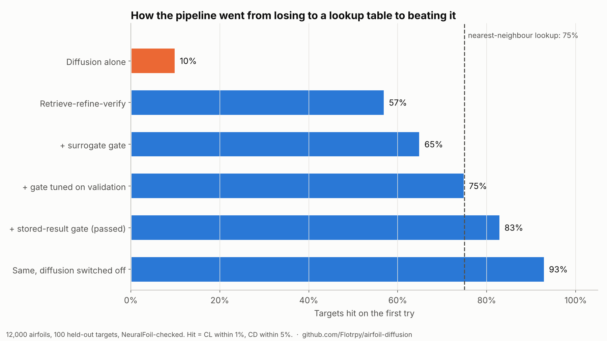
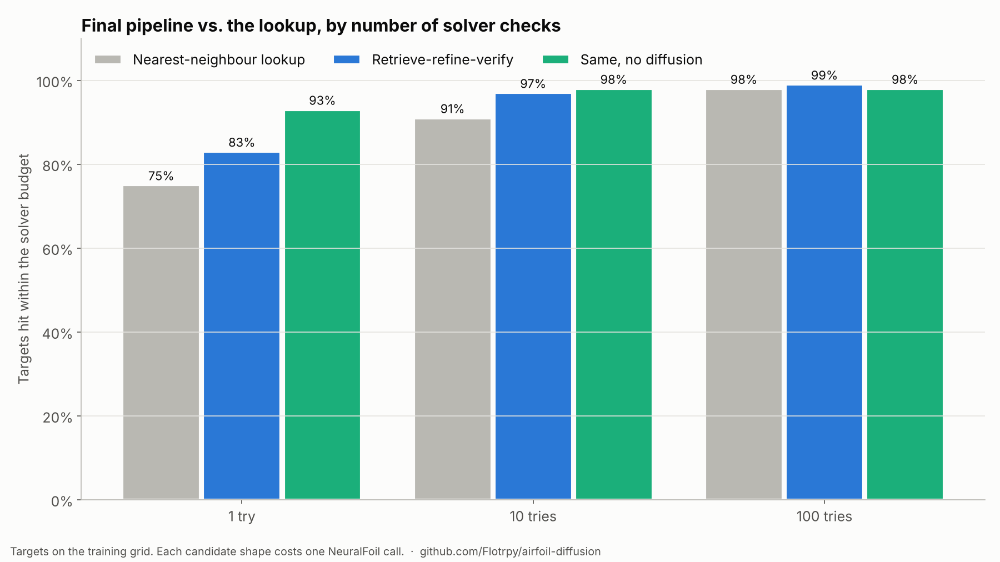
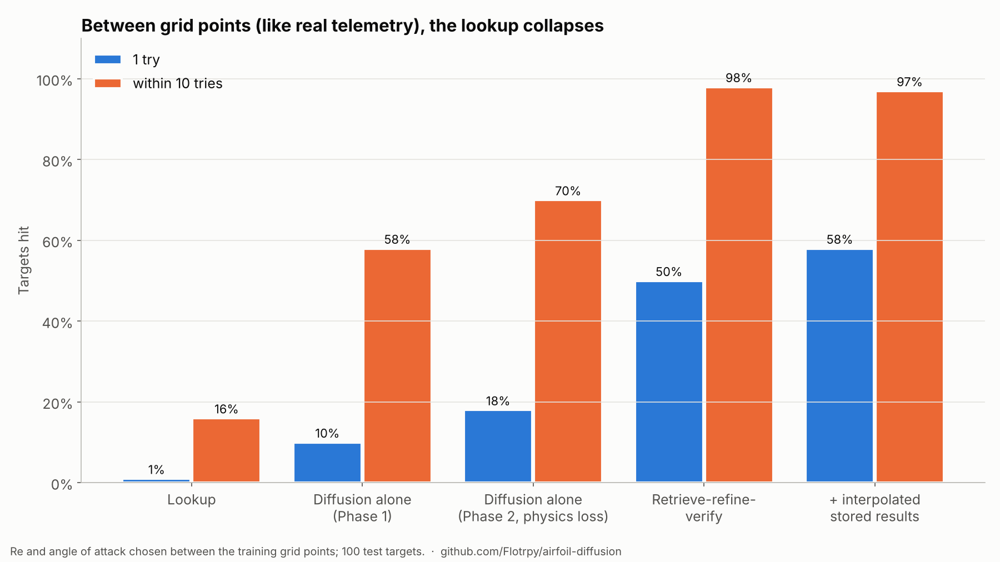
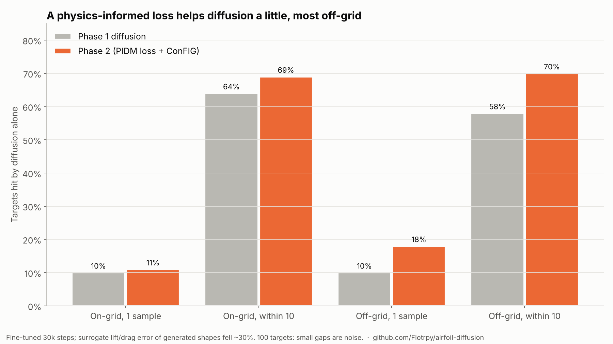

> **Update (Nov 1):** I re-checked everything with an independent solver (XFOIL) and real wind-tunnel data. The headline numbers below were judged by NeuralFoil and don't fully hold up. Between grid points, the method still clearly beats the lookup. See "Update: independent checks" near the end. Paper: https://zenodo.org/records/23851806

## The idea

Designing aerodynamic shapes for EVs or delivery drones means running CFD (computational fluid dynamics) for every shape change, and serious runs can take days. My pitch was:

> Train a diffusion model constrained by the Navier-Stokes equations to instantly generate and optimize surface geometries in real time, based on live wind-tunnel or flight telemetry.

The constraints: **cost $0**, start building now, and base every design decision on a set of 18 research papers.

Code, data and every result: **[github.com/Flotrpy/airfoil-diffusion](https://github.com/Flotrpy/airfoil-diffusion)**

## Scoping it down so it was buildable

Full Navier-Stokes CFD at zero cost isn't realistic, so the first plan shrank the problem:

- **Shapes:** 2-D wing sections (airfoils) for a small delivery drone, described by 11 numbers (a CST/Bernstein parameterisation, following the Airbus diffusion paper).
- **Solver:** [NeuralFoil](https://github.com/peterdsharpe/NeuralFoil), a fast neural stand-in for XFOIL. It is *not* Navier-Stokes, and I say so throughout.
- **Regime:** Reynolds number 2×10⁵ to 3.5×10⁵, angle of attack 0–10°.
- **The task:** given a flight condition and a target lift and drag, propose an airfoil. A **hit** means NeuralFoil confirms lift within 1% and drag within 5% (the tolerances from Geng et al.).
- **Compute:** everything in plain NumPy (no PyTorch) on a free 2-CPU cloud sandbox.

The dataset is 12,000 random airfoils × 44 flight conditions ≈ 350k labelled examples, split *by airfoil*, so the test shapes were never seen in training.

## Iteration 1: diffusion loses to a lookup table

I trained a conditional DDPM (the Airbus architecture) and compared it against a boring baseline: **find the nearest airfoil in the training set and return it.**

| Dataset | Diffusion, 1 sample | Lookup |
|---|---|---|
| 1,000 airfoils | 2% | 30% |
| 6,000 airfoils | 7% | 56% |
| 12,000 airfoils | 10% | 75% |

More data helped both, but diffusion never caught up. My own Phase 1 gate failed.

**Lesson:** always run the dumb baseline. A lookup table over a dense dataset is a strong inverse-design method.

## Iterations 2–4: stop generating from scratch

Instead of throwing away the lookup, I built on top of it with **retrieve → refine → verify**:

1. **Retrieve** the nearest training airfoils.
2. **Refine** them by gradient descent on a small MLP surrogate of the solver (optionally after a light diffusion "warm start").
3. **Verify** every candidate with NeuralFoil; each check counts against the budget.



The first version won at 10 and 100 tries but *lost* on the first try (57% vs 75%). It kept "fixing" airfoils that were already correct.

Adding a gate ("leave it alone if the surrogate says it's already a hit") only got to a tie. **The surrogate's error was about as big as the 1% tolerance**, so it couldn't tell hits from misses.

The fix that worked was almost embarrassingly simple. The targets sit on the same (Re, angle) grid as the training data, and NeuralFoil had *already scored every training airfoil at those exact conditions*. So the gate reads the stored result instead of guessing: zero error, a free bias correction for the surrogate, and no extra solver calls.



**The gate passed: 83% / 97% / 99% vs the lookup's 75% / 91% / 98%.**

Then came the uncomfortable result: **with diffusion switched off, the same pipeline scored 93% on the first try.** A strength sweep on validation data agreed: no diffusion beat every diffusion setting.

## Iteration 5: the realistic test, between grid points

Real telemetry doesn't arrive on a neat grid. Between the grid points, the lookup falls apart and the stored-result trick has nothing to read.



- **Lookup:** 1% on the first try, 16% within 10.
- **Retrieve-refine-verify:** ~50% on the first try, 98% within 10.
- **Iteration 7** interpolates each retrieved airfoil's stored results from the 4 surrounding grid points. That estimate is ~3.5× more accurate than the surrogate and lifts the first try to **58%**.

## Iteration 6: making diffusion physics-aware

Back to the original idea: a *constrained* diffusion model. I fine-tuned it with a PIDM-style loss (the surrogate's lift/drag of each denoised shape must match the request), balanced against the normal denoising loss with ConFIG gradient combining. All of it is hand-written backprop in NumPy, checked against finite differences.



The physics error of generated shapes fell ~30%. Diffusion alone improved modestly, most clearly off-grid (10% → 18% on one sample, 58% → 70% within 10). It still trails direct surrogate polishing.

## Update: independent checks

A commenter ([Dean Lee](https://dev.to/deanlee)) pointed out that a surrogate whose error matches the tolerance turns optimization into noise. The same problem turned out to apply one level up, to the solver itself.

**XFOIL re-check.** XFOIL played no part in training or selection. On the final designs, NeuralFoil and XFOIL disagree by a median of 0.014 in CL (about 2–3%), which is more than my 1% tolerance.

| Targets | Method | NeuralFoil, 1%/5% | XFOIL, 1%/5% | XFOIL, 5%/10% |
|---|---|---|---|---|
| On-grid | Lookup, 1st try | 75% | 15% | 62% |
| On-grid | Pipeline, best of 10 | 96% | 13% | 65% |
| Off-grid | Lookup, 1st try | 1% | 2% | 25% |
| Off-grid | Pipeline, best of 10 | 97% | 22% | 73% |

On the grid, the pipeline's edge disappears under XFOIL. Between grid points, the realistic case for telemetry, it holds at about 3× the lookup.

**Real wind-tunnel data.** I used 100 measured points from the UIUC Low-Speed Airfoil Tests (85 airfoils, Re 1.8–3.6×10⁵). XFOIL on the *actual tested airfoils* misses the measurements by a median of 0.076 in CL and 11% in CD, so 1% agreement with a tunnel isn't realistic at this Reynolds number. Scored by XFOIL, the pipeline's designs come much closer to the measured targets than the lookup's (83% vs 55% within 5%/10% on the first try).

**3-D wing.** I built a tapered drone wing from 3 sections, each at least 10% thick for a spar. Section drag fell 6–10%, and XFOIL confirms about 10% at the root and tip. Whole-wing best L/D went from 19.5 to 20.0 in AeroSandbox, but AeroSandbox uses NeuralFoil inside, so that number isn't independent.

**Lesson:** a model trained and judged by the same fast solver can look far more accurate than it is. Always check with a second judge.

## What I'd tell myself at the start

1. **Beat the baseline before celebrating the model.** The lookup table was the most important experiment in the project.
2. **Your stand-in solver must be more accurate than your tolerance**, or every gate and filter built on it is noise.
3. **Reuse what you've already paid for.** Stored solver results gave an exact gate and a free bias correction.
4. **Test the realistic case.** On-grid numbers looked great; off-grid is where the method actually earns its keep.
5. **Report the ablation that hurts.** Diffusion turned out to be optional here, and that's useful to know.

## Honest limits

- NeuralFoil labels the data and picks the designs. Against XFOIL the 1% CL tolerance isn't met (see the update above); a RANS/Navier-Stokes check is still missing.
- Mostly 2-D sections. The 3-D wing test uses a simple model and only one structural rule (spar depth).
- 100 targets per test set and one run each, so there are no error bars. Differences of a few points are noise.

## Try it

```bash
git clone https://github.com/Flotrpy/airfoil-diffusion
cd airfoil-diffusion
pip install -r requirements.txt
python scripts/01_make_dataset.py --n-airfoils 12000
python scripts/03_train_diffusion.py --steps 200000 --width 128
python scripts/07_refine_eval.py
python scripts/10_validate.py   # XFOIL, wind-tunnel and 3-D checks (needs xfoil + Xvfb)
```

All the numbers in this post are in [`docs/blog/results.csv`](https://github.com/Flotrpy/airfoil-diffusion/blob/main/docs/blog/results.csv) and `results/*.json`. Feedback is very welcome, especially from anyone with access to a real CFD solver.
